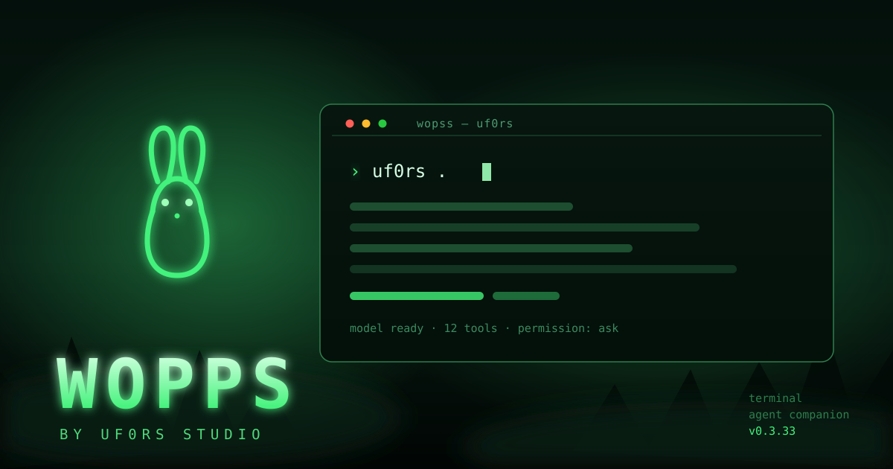

# WOPPS

[Русская версия](README.md)



**WOPPS** is the terminal and desktop AI companion from UF0RS STUDIO. It opens a selected project and provides an interactive TUI for chatting with a model, reviewing its actions, inspecting file changes, and reading command output. Dark forest theme, an ASCII bunny, a slash-command palette, and keyboard and mouse controls.

Current version: **0.3.32**.

## Installation

### Windows — one file

1. Download [uf0rs-install.cmd](https://github.com/uf0rs/wopps-ai/releases/latest/download/uf0rs-install.cmd).
2. Run it with a double click.
3. Open a **new** terminal window and type `uf0rs`.

The script needs neither Node.js nor administrator rights: it downloads `uf0rs.exe` from the latest release, copies it to `%LOCALAPPDATA%\Programs\UF0RS AI`, adds that directory to the user `PATH`, and verifies the result with `uf0rs doctor`. Afterwards `uf0rs` works in any new CMD, PowerShell, Windows Terminal, and Git Bash window. WSL needs the Linux package.

If `uf0rs.exe` already sits next to the script, the download is skipped and that file is installed.

### Windows — from source

Node.js 22+ is required. From the source directory:

```text
install.cmd
```

The script builds a standalone `uf0rs.exe`, installs it into the same directory, and updates `PATH`.

### Linux and macOS

From the source directory:

```sh
chmod +x ./install.sh
./install.sh
```

WOPPS is installed into `~/.local/bin` and the installer appends that directory to supported shell startup files. A new terminal window picks up `PATH`.

### Build from source

Building requires Node.js 22+, npm, and network access: the build script obtains Bun 1.4.4 through npm and uses the frozen lockfile.

```sh
npm ci
npm run build:cli
```

The standalone binary is written to `dist/uf0rs.exe` on Windows or `dist/uf0rs` on Linux/macOS. Build every platform with `npm run build:cli:all`; run the installer tests with `npm test`.

## Commands

```text
uf0rs [path]              Open a project path; defaults to the current directory
uf0rs .                   Open the current directory
uf0rs --resume            Continue the latest session
uf0rs --auto              Start with automatic permission approval
uf0rs models              Configure a provider and model
uf0rs mcp                 Manage local MCP servers
uf0rs --help              Show help
uf0rs --version           Print the version
uf0rs install             Install the CLI for this user and update PATH
uf0rs doctor              Diagnose the installation, PATH, and settings
uf0rs update              Update UF0RS
uf0rs uninstall           Uninstall UF0RS
In the TUI: /language     Choose the interface language
```

Type `/` in the TUI to open the slash-command palette. `/auto_mod` toggles permission prompts for the current run; `/auto_mod on` and `/auto_mod off` set the mode explicitly. `/auto_mode` remains an alias. Automatic approval skips permission prompts for model actions, so enable it only when you trust the requests and selected model.

## Projects and computer tools

WOPPS can inspect project structure, search and read files, propose and apply edits, show diffs, run commands, and execute tests. Computer-control tools are exposed through a local UF0RS STUDIO MCP bridge. Actions requiring permission ask first by default; WOPPS does not bypass operating-system permissions.

The model core supports providers including Ollama and OpenAI-compatible APIs. For `llama.cpp`, run `llama-server` separately and connect its OpenAI-compatible endpoint. UF0RS does not require an account or server from the source project; providers and MCP servers you choose may use their own external services.

After you connect OpenRouter, WOPPS refreshes the model list from OpenRouter's catalog. The picker keeps text models that support tool calls, which are required for project work and computer control. If OpenRouter was configured in an earlier WOPPS version, its settings and selected model are imported from `~/.uf0rs/config.json` on first launch.

## Updating and removing

`uf0rs update` downloads the latest GitHub release (or rebuilds from the saved source directory) and replaces the executable. Updating works while WOPPS is running: the live `uf0rs.exe` is renamed to `uf0rs.old.exe`, the new file takes its place, and the next start uses it. `uf0rs uninstall` removes the program and its `PATH` entry while keeping settings and history.

Settings, state, and conversation history are stored locally under `~/.uf0rs` (Windows: `%USERPROFILE%\.uf0rs`). Prompts, file contents, and command results are sent to the selected model when needed to answer.

The integrated TUI currently has English labels; Russian and French localization from the previous interface has not yet been ported.

## Third-party code

The local CLI/TUI engine is distributed under the MIT license. Its notice is preserved in [uf0rs-engine/LICENSE](uf0rs-engine/LICENSE).
