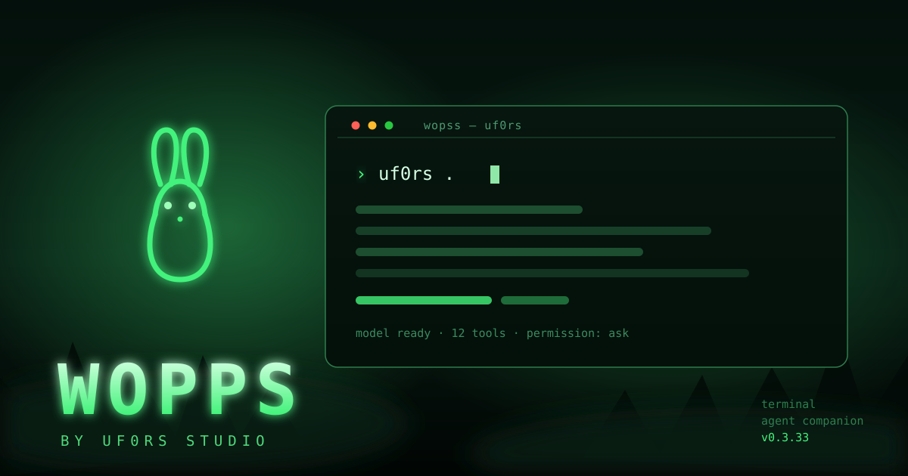

# WOPPS

[English version](README.en.md)



**WOPPS** — локальный ИИ-помощник UF0RS STUDIO для терминала и рабочего стола. Открывает выбранный проект, ведёт диалог в интерактивном TUI, показывает действия модели, изменения файлов и вывод команд. Тёмная лесная тема, ASCII-зайчик, палитра slash-команд, управление клавиатурой и мышью.

Текущая версия: **0.3.33**.

## Установка

### Windows — одним файлом

1. Скачайте [uf0rs-install.cmd](https://github.com/uf0rs/wopps-ai/releases/latest/download/uf0rs-install.cmd).
2. Запустите его двойным кликом.
3. Откройте **новое** окно терминала и введите `uf0rs`.

Батник не требует Node.js и прав администратора: он скачивает `uf0rs.exe` из последнего релиза, кладёт его в `%LOCALAPPDATA%\Programs\UF0RS AI`, добавляет этот каталог в пользовательский `PATH` и проверяет результат командой `uf0rs doctor`. После этого команда `uf0rs` работает в любом новом окне CMD, PowerShell, Windows Terminal и Git Bash. В WSL нужен Linux-пакет.

Если `uf0rs.exe` уже лежит рядом с батником, скачивание пропускается и ставится этот файл.

### Windows — из исходников

Нужен Node.js 22+. Из каталога исходников:

```text
install.cmd
```

Скрипт соберёт автономный `uf0rs.exe`, установит его в тот же каталог и обновит `PATH`.

### Linux и macOS

Из каталога исходников:

```sh
chmod +x ./install.sh
./install.sh
```

WOPPS ставится в `~/.local/bin`, установщик дописывает этот каталог в файлы настройки оболочки. Новое окно терминала подхватит `PATH`.

### Сборка из исходников

Нужны Node.js 22+, npm и доступ к сети: скрипт сборки получает Bun 1.4.4 через npm и использует зафиксированный lockfile.

```sh
npm ci
npm run build:cli
```

Готовый файл — `dist/uf0rs.exe` на Windows или `dist/uf0rs` на Linux/macOS. Сборка всех платформ: `npm run build:cli:all`. Тесты установщика: `npm test`.

## Команды

```text
uf0rs [путь]                 Открыть указанный проект; без пути — текущую папку
uf0rs .                      Открыть текущую папку
uf0rs --resume               Продолжить последнюю сессию
uf0rs --auto                 Запустить с автоматическим одобрением разрешений
uf0rs models                 Настроить провайдера и модель
uf0rs mcp                    Управлять локальными MCP-серверами
uf0rs --help                 Показать справку
uf0rs --version              Показать версию
uf0rs install                Установить CLI в профиль пользователя и обновить PATH
uf0rs doctor                 Проверить установку, PATH и настройки
uf0rs update                 Обновить программу
uf0rs uninstall              Удалить программу
В TUI: /language             Выбрать язык интерфейса
```

В TUI введите `/`, чтобы открыть палитру slash-команд. `/auto_mod` переключает запросы подтверждения на время текущего запуска; `/auto_mod on` и `/auto_mod off` задают режим явно. `/auto_mode` остаётся совместимым псевдонимом. Автоодобрение отключает подтверждения действий модели, поэтому включайте его только если доверяете запросам и выбранной модели.

## Работа с проектом и компьютером

WOPPS может исследовать структуру проекта, искать и читать файлы, предлагать и применять изменения, показывать diff, выполнять команды и запускать тесты. Доступ к инструментам управления компьютером предоставляется через локальный MCP-мост UF0RS STUDIO. По умолчанию действия, требующие разрешения, спрашивают подтверждение; ограничения операционной системы и разрешения не обходятся.

Доступны провайдеры моделей, поддерживаемые ядром, включая Ollama и OpenAI-совместимые API. Для `llama.cpp` запустите `llama-server` отдельно и подключите его OpenAI-совместимый endpoint. Интеграция не требует учётной записи или серверов исходного проекта; выбранные вами провайдеры и MCP-серверы могут использовать собственные внешние сервисы.

После подключения OpenRouter WOPPS обновляет список моделей из каталога OpenRouter. В выборе остаются текстовые модели с поддержкой вызова инструментов, необходимые для работы с проектами и управления компьютером. Если OpenRouter уже был настроен в старой версии WOPPS, при первом запуске настройки и выбранная модель переносятся из `~/.uf0rs/config.json`.

## Обновление и удаление

`uf0rs update` скачивает последний релиз с GitHub (или собирает из сохранённого каталога исходников) и заменяет исполняемый файл. Обновление проходит даже при открытом WOPPS: запущенный `uf0rs.exe` переименовывается в `uf0rs.old.exe`, а новый файл встаёт на его место и подхватывается при следующем запуске. `uf0rs uninstall` убирает программу и запись из `PATH`, сохраняя настройки и историю.

Настройки, состояние и история хранятся локально в `~/.uf0rs` (Windows: `%USERPROFILE%\.uf0rs`). Запросы, содержимое файлов и результаты команд отправляются выбранной модели, когда они нужны для ответа.

Основной TUI этой интеграции пока использует английские подписи; русская и французская локализация прежнего интерфейса ещё не перенесена.

## Сторонний код

Локальное CLI/TUI-ядро распространяется по лицензии MIT; уведомление сохранено в [uf0rs-engine/LICENSE](uf0rs-engine/LICENSE).
