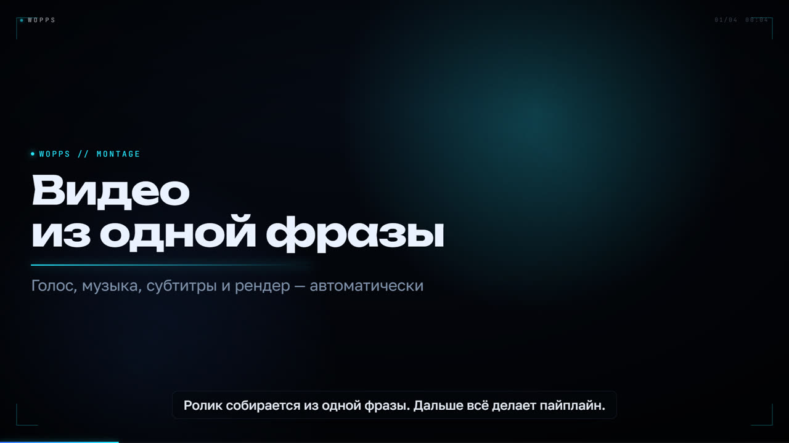
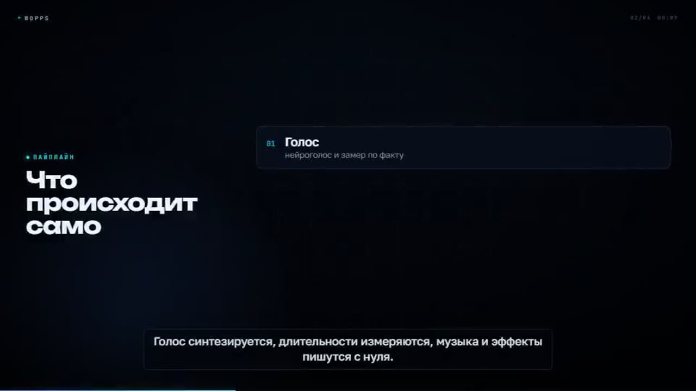

# WOPPS Montage

Монтаж кодом: одна фраза → бриф → раскадровка → голос → музыка → MP4.



В отличие от «генерации видео», здесь нет видеомодели. Ролик собирается из кода (React + Remotion),
поэтому любое изменение — слово, число, тайминг — меняет только нужное место, а не пересобирает всё.
Это тот же принцип, что у Claude Motion: анимация как артефакт-код.

---

## 1. Быстрый старт

Один раз на машину:

```powershell
node "$HOME/.config/uf0rs/montage/bin/montage.mjs" setup
node "$HOME/.config/uf0rs/montage/bin/montage.mjs" doctor
```

`setup` кладёт Remotion, `ffmpeg-static`, `ffprobe-static` и headless-браузер в
`~/.cache/uf0rs/montage` и проверяет `numpy` / `edge-tts`.

Новый ролик:

```powershell
node "$HOME/.config/uf0rs/montage/bin/montage.mjs" init "montage/launch" --title "Запуск продукта" --seconds 60
node "$HOME/.config/uf0rs/montage/bin/montage.mjs" build "montage/launch" --profile draft
node "$HOME/.config/uf0rs/montage/bin/montage.mjs" build "montage/launch" --profile final
node "$HOME/.config/uf0rs/montage/bin/montage.mjs" qa "montage/launch"
```

В TUI это делает команда `/montage`: агент сам задаёт бриф, пишет `scenes.json` и гоняет сборку.

---

## 2. Требования

| Что | Зачем | Как получить |
|---|---|---|
| Node.js 22+ | CLI, Remotion | https://nodejs.org |
| python + numpy | музыка, SFX, сведение | `python -m pip install numpy` |
| python + edge-tts | бесплатный нейроголос | `python -m pip install edge-tts` |
| ffmpeg / ffprobe | замеры, mux, QA | `montage setup` (ffmpeg-static) |
| Remotion | рендер | `montage setup` (npm + браузер) |

Без Python ролик соберётся без голоса и музыки (`--no-voice --no-music`), визуал — полностью рабочий.
Поддерживаются Windows, Linux и macOS.

---

## 3. Архитектура

```
brief.json + scenes.json
        │
        ├─ voice.py       edge-tts → mp3 по репликам (кэш по хешу текста)
        │       │
        │       └─ ffprobe → реальные длительности
        ▼
   timeline.json + subtitles.srt      ← единственный источник тайминга
        │
        ├─ music.py       numpy-партитура под сцены (Am–F–C–G, 104 BPM)
        ├─ sfx.py         17 эффектов из шума и осцилляторов (один раз)
        ▼
    mix.py                голос + дакинг + SFX + мастер
        │
        ▼
   Remotion (12 типов сцен)  ── параллельные куски ──► ffmpeg concat ──► mux AAC
        │
        ▼
   out/draft.mp4 · out/final.mp4 · out/qa.json · out/poster.png
```

Ключевое: **голос диктует тайминг**. Длительность сцены = вход 0.26 с + сумма реальных mp3 + хвост по типу.
Поэтому субтитры, музыкальные акценты и каты не могут разъехаться «на слух» — они считаются из одного файла.

---

## 4. Файлы проекта

```
montage/launch/
├─ brief.json        вход: тема, формат, fps, голос, музыка, бренд
├─ scenes.json       вход: раскадровка
├─ assets/           скриншоты, логотип, картинки
├─ project.json      производный input-props для Remotion
├─ timeline.json     производный таймлайн (кадры, реплики, субтитры)
├─ subtitles.srt     производный
├─ .montage/         кэш: vo/, vo_wav/, cache/score.wav, cache/mix.wav, state.json
└─ out/              draft.mp4, final.mp4, video-*.mp4, render-*/part-*.mp4, qa.json, poster.png
```

Правите только `brief.json`, `scenes.json` и `assets/`.

### brief.json

```json
{
  "slug": "launch",
  "title": "Запуск продукта",
  "lang": "ru",
  "aspect": "16:9",
  "fps": 30,
  "brand": { "name": "WOPPS", "accent": "#28E9FF" },
  "theme": "dark",
  "voice": "ru-RU-DmitryNeural",
  "voiceRate": "+6%",
  "music": { "mood": "tech", "enabled": true },
  "hud": true,
  "captions": true
}
```

`aspect`: `16:9`, `9:16`, `1:1`, `4:5`, `4k`. `theme`: `dark` или `light`.
`music.mood`: `tech`, `calm`, `warm`.

---

## 5. Сцены

`scenes.json` — массив `scenes`. Общие поля: `id`, `type`, `vo`, `bg`, `accent`, `duration`
(секунды, только если нет `vo`), `energy` (0–1), `mood`.

| Тип | Для чего | Обязательные поля |
|---|---|---|
| `title` | хук, первый кадр | `headline` |
| `statement` | крупное заявление | `lines[]` |
| `bullets` | список тезисов | `items[{title,text}]` |
| `terminal` | команды и вывод | `commands[{cmd,out[]}]` |
| `code` | код с подсветкой и diff | `lines[{text,kind}]` |
| `window` | мокап интерфейса | `cards[]` или `url` |
| `screenshot` | реальный скриншот + выноски | `screenshot` |
| `stats` | цифры с анимацией | `items[{label,value}]` |
| `compare` | было / стало | `left`, `right` |
| `steps` | процесс по шагам | `items[{title,text}]` |
| `montage` | грид карточек под бит | `cards[]` |
| `quote` | цитата | `text` |
| `outro` | финал и CTA | `headline` |

Фоны: `flat`, `grid`, `particles`, `glow`, `floor`, `nebula`.
Подробные примеры — в скилле `montage-scenes` (`.config/uf0rs/skill/montage-scenes/SKILL.md`).



Пример:

```json
{
  "scenes": [
    { "id": "s01", "type": "title", "kicker": "WOPPS", "headline": "Видео\nиз одной фразы",
      "sub": "Голос, музыка и рендер — автоматически", "bg": "glow",
      "vo": "Ролик собирается из одной фразы." },
    { "id": "s02", "type": "stats", "title": "Один прогон",
      "items": [{ "label": "сцен", "value": 16 }, { "label": "реплик", "value": 112 }],
      "bg": "grid", "vo": "Шестнадцать сцен и сто двенадцать реплик." },
    { "id": "s03", "type": "outro", "headline": "Готово.", "cta": "/montage",
      "bg": "nebula", "vo": "Готово. Один бриф — один файл." }
  ]
}
```

---

## 6. Команды

```text
montage setup                                  поставить движок (один раз)
montage doctor                                 диагностика окружения
montage init <dir> [--brief file | --title …]   создать проект
montage plan [<dir>]                           показать формат сцен
montage build <dir> --profile draft|final      весь пайплайн
montage status <dir>                           сцены, тайминги, файлы
montage qa <dir>                               приёмка и отчёт
montage poster <dir> [--frame N]               кадр-обложка PNG
montage studio <dir>                           живое превью Remotion
montage clean <dir> [--all] [--video]          очистка кэша/результатов
```

Флаги `build`:

| Флаг | Смысл |
|---|---|
| `--profile draft` | 0.5×, crf 30, veryfast — для ритма и текста |
| `--profile final` | полный размер, crf 16, medium |
| `--no-voice` | без озвучки, длительности из `scenes.json` |
| `--no-music` | без партитуры |
| `--segments N` | на сколько кусков делить рендер (по умолчанию 2/3) |
| `--force` | игнорировать кэш |

---

## 7. Скорость

Кэш — по контент-хешам, на каждом шаге:

| Шаг | Хеш | Что переиспользуется |
|---|---|---|
| голос | текст + голос + rate по строке | mp3 каждой неизменной реплики |
| музыка | длительность + энергия сцен + mood | `score.wav` |
| микс | таймлайн + хеш голоса + музыка | `mix.wav` |
| рендер | props + профиль + исходники движка | готовый `video-*.mp4` |

Плюс параллельные куски: кадры делятся на 2–3 диапазона, каждый рендерится своим процессом
Remotion, потом `ffmpeg -c copy` склеивает без перекодирования.

Замеры на i5-13400F / 16 потоков / 32 ГБ (этот репозиторий, движок 12 сцен):

| Ролик | Профиль | Время |
|---|---|---|
| 27 с, 4 сцены, голос + музыка | draft 960×540 | ~6 с рендера, ~20 с весь пайплайн |
| 27 с, 4 сцены | final 1920×1080 | ~31 с рендера (3 куска) |
| 41 с, 12 сцен, без голоса | draft 540×960 | ~33 с рендера |

Экстраполяция на 10 минут: черновик ≈ 4–8 мин, финал ≈ 12–20 мин — при условии, что не менялся
голос и музыка (иначе добавьте 1–2 мин на синтез и сведение).

---

## 8. Звук

- Голос: edge-tts, `ru-RU-DmitryNeural` по умолчанию. Пики реплик выравниваются, края — 12 мс фейда.
- Музыка: процедурная партитура 48 кГц стерео, аккорды Am–F–C–G, барабаны/арпеджио/пэды,
  энергия зависит от сцены.
- SFX: каты, печать, счётчики, карточки, финальный сабдроп — по монтажным точкам.
- Дакинг: огибающая голоса на 200 Гц, attack 10 мс, release 320 мс, до −74 % музыки под речью.
- Мастер: нормализация пика, `tanh`, фейды. Цель — −14 LUFS, true peak ≤ −1.5 dBTP.

Проверка: `montage qa` (ebur128 + blackdetect + ffprobe).

---

## 9. Как это встроено в WOPPS

Кит устанавливается в двух местах:

```
~/.uf0rs/                    ← конфиг домашней папки: виден из любого проекта под ~
├─ command/montage.md        ← slash-команда /montage
├─ agent/montage.md          ← агент-режиссёр (переключается командой)
└─ skill/montage-*/SKILL.md  ← director, scenes, sound, pipeline, qa

~/.config/uf0rs/montage/     ← сама студия
├─ bin/montage.mjs           ← CLI
├─ engine/                   ← исходники Remotion-движка (синхронизируются в кэш при build)
├─ python/                   ← voice, music, sfx, mix
└─ installed.json
```

Дополнительно те же `command/agent/skill` копируются в глобальный конфиг
(`$XDG_CONFIG_HOME/uf0rs`, по умолчанию `~/.config/uf0rs`) — на случай, если WOPPS
запущен с другим `XDG_CONFIG_HOME`.

`/montage` переключает сессию на агента `montage` и подставляет инструкцию: спросить бриф,
собрать `scenes.json`, гонять draft/final. Другие сессии не затрагиваются.

Если проект лежит **вне** домашней папки (другой диск), скопируйте `command/montage.md`
и `agent/montage.md` в `<проект>/.uf0rs/` — остальное продолжит работать из `~/.config`.

Установка/обновление кита:

```powershell
node montage/install.mjs            # из репозитория
# или автоматически при `uf0rs install` / `uf0rs update` из исходников
```

Движок (`~/.cache/uf0rs/montage/engine`) синхронизируется из кита при каждом `build`,
поэтому обновление кита подхватывается без переустановки зависимостей.

---

## 10. Ограничения

- Нет генерации фотореалистичного видео: визуал — типографика, код, UI, цифры, частицы, 3D-фоны.
  Реальные кадры — только ваши скриншоты и изображения из `assets/`.
- Голос — edge-tts. Он хорош, но не «дышит» как премиум-TTS; при наличии ключа можно добавить
  другого провайдера в `python/voice.py`.
- Музыка процедурная: попадание в настроение, но не замена лицензионному треку.
- Remotion: бесплатен для частных лиц и компаний ≤3 человек; коммерческое использование
  в большей компании требует лицензии (https://remotion.pro/license).
- Шрифты (Unbounded, Golos Text, JetBrains Mono, Oswald, Manrope) — SIL Open Font License.

---

## 11. Диагностика

| Симптом | Решение |
|---|---|
| `движок монтажа не установлен` | `montage setup` |
| `ffmpeg не найден` | `montage setup` или `MONTAGE_FFMPEG` / `MONTAGE_FFPROBE` |
| `edge-tts is not installed` | `python -m pip install edge-tts` |
| `mix.py упал` | проверьте `MONTAGE_DEBUG=1`, чаще всего нет numpy |
| рендер упал | `MONTAGE_DEBUG=1` + `--log=verbose`; повторный `build` продолжит с кэша |
| текст обрезан | короче заголовок (≤ 8 слов; в 9:16 ≤ 6) |
| слишком громко | ниже `energy` у плотных сцен, либо `--no-music` |
| webpack cache warning | безвредно: два параллельных куска не делят кэш, рендер продолжается |
